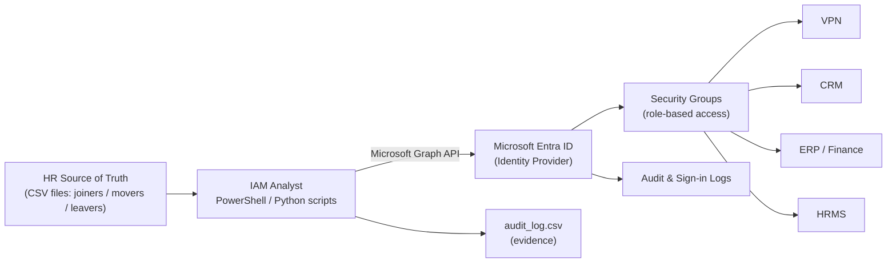
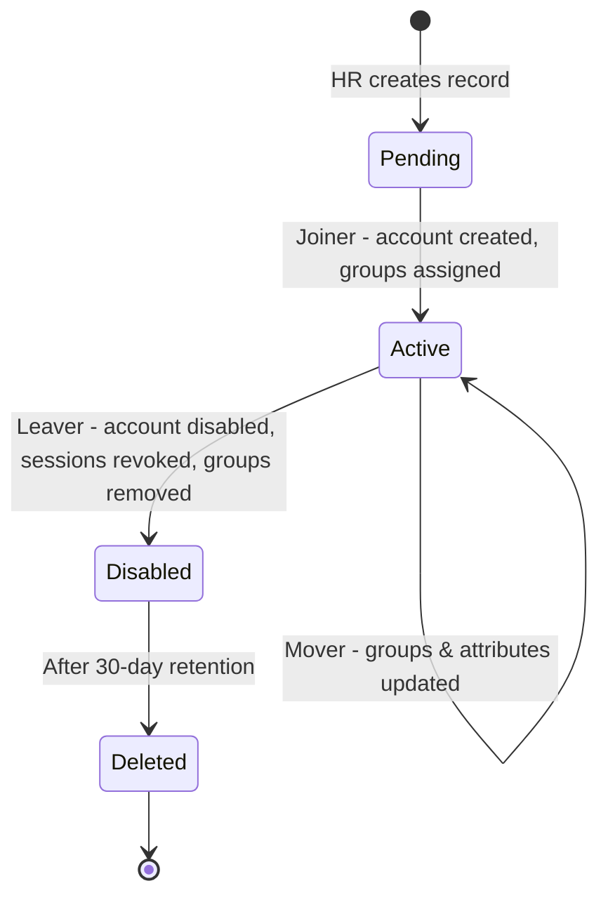
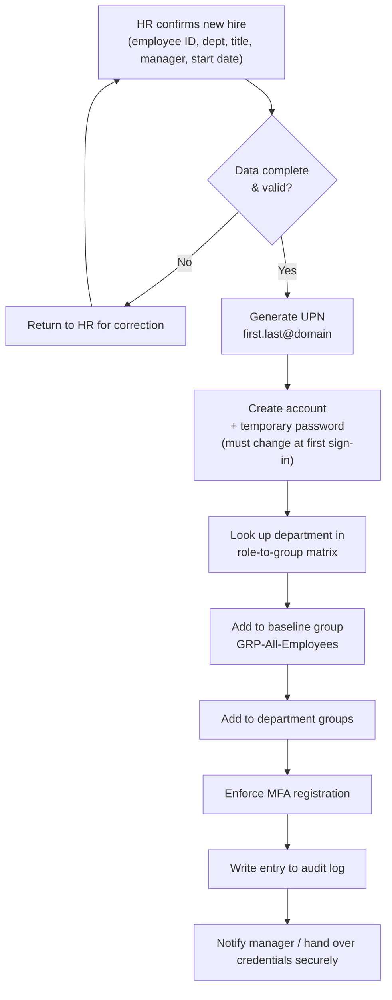
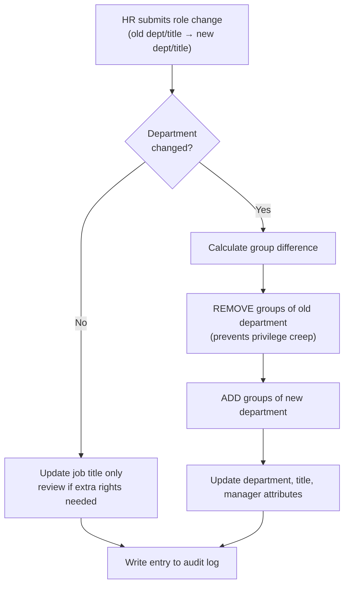
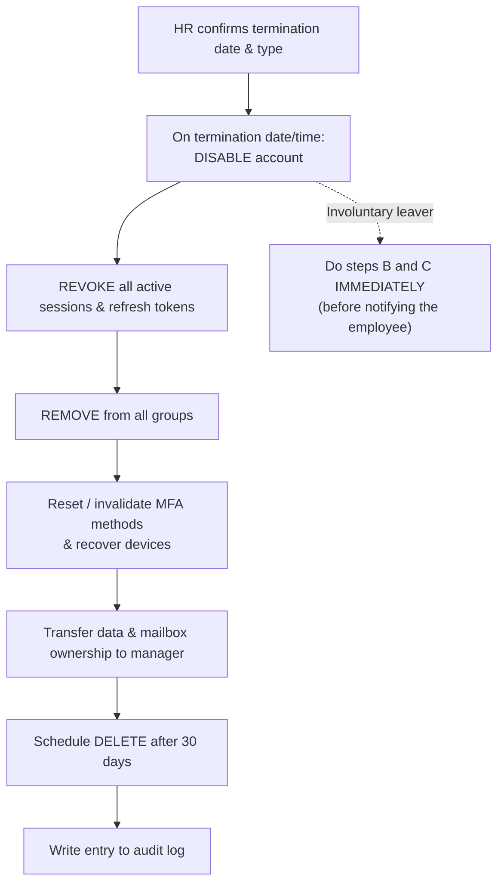
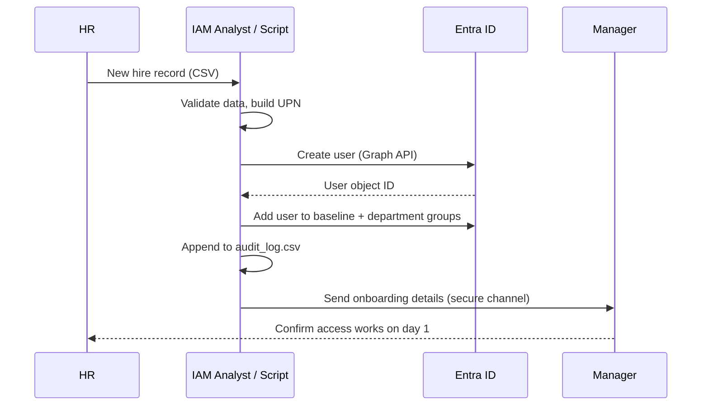

# User Lifecycle Management Lab (Joiner • Mover • Leaver)

> A hands-on Identity & Access Management (IAM) lab that simulates the full user lifecycle in **Microsoft Entra ID** (formerly Azure AD): onboarding new hires, adjusting access when people change roles, and fully revoking access when they leave.

   

---

## 📌 Table of Contents
1. [Objective](#-objective)
2. [Business problem](#-business-problem)
3. [Architecture](#-architecture)
4. [Lifecycle processes (diagrams)](#-lifecycle-processes)
5. [Access model (role → group matrix)](#-access-model)
6. [Repository structure](#-repository-structure)
7. [How to reproduce the lab](#-how-to-reproduce-the-lab)
8. [Test cases & results](#-test-cases--results)
9. [Security principles applied](#-security-principles-applied)
10. [Skills demonstrated](#-skills-demonstrated)
11. [Lessons learned / improvements](#-lessons-learned--possible-improvements)

---

## 🎯 Objective
Design, implement and document an end-to-end **Joiner–Mover–Leaver (JML)** process so that:
- new employees receive the **right access on day one** (and nothing extra),
- people who change roles **lose old access** (no privilege creep),
- people who leave have **all access revoked immediately** and accounts removed after a retention period,
- every action produces **audit evidence**.

## ❗ Business problem
| Without a JML process | Risk |
|---|---|
| Access requested ad hoc via emails/tickets | Inconsistent, slow onboarding |
| Old permissions kept after a transfer | **Privilege creep**, segregation-of-duties violations |
| Leavers' accounts left active | **Orphaned accounts**, insider/credential-theft risk, audit findings |
| No records of who did what | Failed audits (SOX, ISO 27001, SOC 2) |

## 🏗 Architecture



**Key design decision:** access is granted through **groups mapped to departments**, never directly to individual users. This makes mover/leaver handling a simple group add/remove and makes access reviews easy.

## 🔄 Lifecycle processes

### Overall lifecycle



### 1️⃣ Joiner (onboarding)



### 2️⃣ Mover (internal transfer / promotion)



### 3️⃣ Leaver (offboarding)



### Joiner sequence (who talks to whom)



## 🔐 Access model

| Department | Groups assigned | Grants access to |
|---|---|---|
| *(everyone)* | `GRP-All-Employees` | Intranet, email, collaboration tools |
| IT | `GRP-IT-Staff`, `GRP-VPN-Users` | IT tools, VPN |
| HR | `GRP-HR-Staff`, `GRP-HRMS-Access` | HR system |
| Finance | `GRP-Finance-Staff`, `GRP-ERP-Finance` | ERP / finance apps |
| Sales | `GRP-Sales-Staff`, `GRP-CRM-Users` | CRM |

Source file: [`data/role_group_map.csv`](data/role_group_map.csv)

## 📁 Repository structure

```
iam-user-lifecycle-management/
├── README.md                  ← you are here
├── docs/
│   ├── 01-lab-setup.md        ← tenant, groups, tools
│   ├── 02-joiner-process.md   ← SOP + manual steps
│   ├── 03-mover-process.md
│   ├── 04-leaver-process.md
│   ├── 05-test-cases.md       ← test plan & results
│   └── 06-risks-and-controls.md
├── data/                      ← sample HR data (fictional)
│   ├── joiners.csv
│   ├── movers.csv
│   ├── leavers.csv
│   └── role_group_map.csv
├── scripts/
│   ├── jml_graph.ps1          ← real automation (Microsoft Graph)
│   └── jml_simulator.py       ← offline simulator, produces audit log
├── output/                    ← sample audit evidence
│   ├── audit_log.csv
│   └── final_state.csv
└── evidence/                  ← your screenshots go here
```

## 🧪 How to reproduce the lab

**Option A – Offline (no cloud account)**
```bash
git clone https://github.com/<your-username>/iam-user-lifecycle-management.git
cd iam-user-lifecycle-management
python scripts/jml_simulator.py
```
This generates `output/audit_log.csv` and `output/final_state.csv`.

**Option B – Real tenant (recommended for screenshots)**
1. Create a free Microsoft Entra ID tenant (see [docs/01-lab-setup.md](docs/01-lab-setup.md)).
2. Create the security groups listed in the access model.
3. Run the automation (dry-run first):
```powershell
Install-Module Microsoft.Graph -Scope CurrentUser
.\scripts\jml_graph.ps1 -Mode Joiner -Domain "yourtenant.onmicrosoft.com" -DryRun
.\scripts\jml_graph.ps1 -Mode Joiner -Domain "yourtenant.onmicrosoft.com"
.\scripts\jml_graph.ps1 -Mode Mover  -Domain "yourtenant.onmicrosoft.com"
.\scripts\jml_graph.ps1 -Mode Leaver -Domain "yourtenant.onmicrosoft.com"
```
4. Capture screenshots into `evidence/` (list in [docs/05-test-cases.md](docs/05-test-cases.md)).

## ✅ Test cases & results
Full plan: [docs/05-test-cases.md](docs/05-test-cases.md). Simulator results with the sample data:

| Metric | Result |
|---|---|
| Joiners processed | 8 |
| Movers processed | 3 (2 department changes, 1 promotion) |
| Leavers processed | 2 (1 voluntary, 1 involuntary) |
| Audit events logged | 55 |
| Active accounts at end | 6 |
| Disabled accounts (pending deletion) | 2 |
| Leavers with remaining group membership | **0** |
| Movers with old-department groups remaining | **0** |

## 🛡 Security principles applied
- **Least privilege** – only department-based groups; no direct app assignments.
- **Separation of duties** – HR supplies data, IAM executes, manager confirms.
- **Privilege-creep prevention** – old groups are *removed* on every move.
- **Timely revocation** – leavers disabled + sessions revoked on termination day.
- **Accountability** – every action logged with date, event, user, action.
- **Secure defaults** – random temp passwords, forced change at first sign-in, MFA required.

## 🧰 Skills demonstrated
User provisioning & deprovisioning • JML process design • RBAC/group-based access • Least privilege • Microsoft Entra ID • Microsoft Graph PowerShell • Python scripting • Audit evidence & documentation

## 📈 Lessons learned / possible improvements
- Connect to an HR system (e.g. Workday/SuccessFactors) for automatic triggers instead of CSVs.
- Use **dynamic groups** (Entra ID P1/P2) so department changes update access automatically.
- Add **access reviews** (see Project 6 in the series) to catch drift.
- Add approval workflow for sensitive groups and a ticketing integration (ServiceNow / Jira).

---
*All names, IDs and domains in this repository are fictional and created for learning purposes.*
